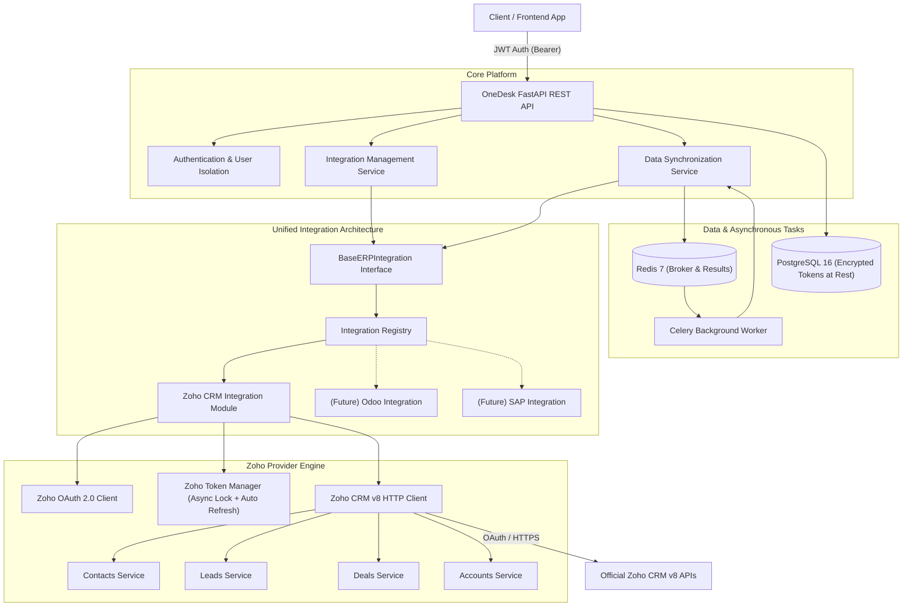

# OneDesk — Unified ERP Integration Platform

**OneDesk** is a modular, scalable, multi-tenant ERP integration platform built with **Python 3.11+**, **FastAPI**, **SQLAlchemy 2.0 (async)**, **PostgreSQL**, **Redis**, and **Celery**. 

It acts as a centralized integration layer between client applications and external ERP systems, exposing a clean, unified REST API while abstracting provider-specific authentication, rate limits, pagination, data structures, and OAuth 2.0 lifecycles.

**Initial Supported Provider:** Zoho CRM v8 API  
**Designed For Extensibility:** Out-of-the-box architecture ready for Odoo, SAP, and custom ERP connectors without modifying platform core.

---

## 1. System Architecture



---

## 2. Key Features

- **Multi-Tenant User Isolation**: Every ERP connection, token, and sync log is strictly scoped to the authenticated user. Cross-tenant access attempts return `404 Not Found`.
- **At-Rest Token Encryption (Fernet/AES-128-CBC)**: OAuth access and refresh tokens are encrypted transparently by a custom SQLAlchemy `TypeDecorator` (`EncryptedString`) before hitting PostgreSQL disk storage. Tokens are never exposed in API responses or logs.
- **CSRF-Protected OAuth State**: Cryptographically signed state JWTs carry tenant ID, connection label, and data center metadata with strict 15-minute expirations.
- **Global Data Center Agnosticism**: Supports all global Zoho data centers (`us`, `eu`, `in`, `cn`, `au`, `ca`, `jp`) with dynamic API routing.
- **Proactive & Reactive Token Refresh**: Automatically detects token expiration with a 5-minute safety margin; intercepts external HTTP 401 Unauthorized responses to perform an immediate token refresh and request retry.
- **Concurrency Locking**: Employs per-integration async locks to prevent duplicate concurrent refresh requests to Zoho Accounts.
- **Rate Limit & Transient Retry Handling**: Captures HTTP 429 rate limits, parses `Retry-After` headers, and applies exponential backoff.
- **Unified & Incremental Sync**: Supports on-demand and background Celery synchronization with `If-Modified-Since` ISO-8601 delta timestamps.

---

## 3. Technology Stack

- **Language:** Python 3.11+
- **Web Framework:** FastAPI
- **Database:** PostgreSQL 16
- **ORM:** SQLAlchemy 2.0 (Full Asyncio Support with `asyncpg` and `greenlet`)
- **Migrations:** Alembic (Async Environment)
- **Background Queue & Cache:** Redis 7 + Celery 5.3+
- **HTTP Client:** HTTPX (Asynchronous HTTP/2 ready)
- **Validation & Settings:** Pydantic v2 + Pydantic-Settings
- **Security:** Passlib (Bcrypt), Cryptography (Fernet), PyJWT
- **Testing:** Pytest, Pytest-Asyncio, AioSQLite
- **Containerization:** Docker & Docker Compose

---

## 4. Project Directory Structure

```text
backend/
├── app/
│   ├── main.py                      # FastAPI app factory, CORS, centralized exception handlers
│   │
│   ├── core/                        # Core configuration and infrastructure
│   │   ├── config.py                # Pydantic v2 BaseSettings
│   │   ├── database.py              # Async engine, sessionmaker, get_db dependency
│   │   ├── security.py              # Bcrypt hashing, JWT helpers, Fernet token encryption
│   │   └── logging.py               # Centralized structured logger
│   │
│   ├── api/                         # Presentation layer & API routers
│   │   ├── dependencies.py          # get_current_user, get_db dependencies
│   │   ├── routes.py                # API v1 router mounting
│   │   └── integrations_router.py   # Connection management & sync endpoints
│   │
│   ├── auth/                        # User authentication module
│   │   ├── router.py                # /api/v1/auth (register, login, me)
│   │   ├── schemas.py               # Pydantic user & token schemas
│   │   └── service.py               # User registration and verification logic
│   │
│   ├── integrations/                # Multi-ERP integration layer
│   │   ├── base.py                  # BaseERPIntegration abstract base class
│   │   ├── registry.py              # Singleton IntegrationRegistry
│   │   │
│   │   └── zoho/                    # Zoho CRM module
│   │       ├── oauth.py             # Data center mapping, state handling, code exchange
│   │       ├── token_manager.py     # Concurrency-safe proactive & reactive token refresh
│   │       ├── client.py            # Zoho CRM v8 HTTP client with rate-limiting & 401 retry
│   │       ├── integration.py       # BaseERPIntegration concrete implementation
│   │       ├── exceptions.py        # Domain exception hierarchy
│   │       ├── router.py            # /connect and /callback endpoints
│   │       ├── crm_router.py        # /api/v1/zoho (contacts, leads, deals, accounts)
│   │       │
│   │       ├── services/            # CRM resource services
│   │       │   ├── contacts.py      # ZohoContactsService
│   │       │   ├── leads.py         # ZohoLeadsService
│   │       │   ├── deals.py         # ZohoDealsService
│   │       │   └── accounts.py      # ZohoAccountsService
│   │       │
│   │       └── schemas/             # Normalized CRM schemas
│   │           └── crm.py           # ZohoContact, ZohoLead, ZohoDeal, ZohoAccount
│   │
│   ├── models/                      # SQLAlchemy 2.0 ORM models
│   │   ├── base.py                  # Base, TimestampMixin, EncryptedString TypeDecorator
│   │   ├── user.py                  # User model
│   │   ├── integration.py           # Integration model (encrypted tokens, compound index)
│   │   └── sync_history.py          # SyncHistory audit tracking model
│   │
│   ├── repositories/                # Data access layer
│   │   ├── user_repository.py       # User entity database operations
│   │   └── integration_repository.py# Integration entity database operations
│   │
│   ├── services/                    # Application services
│   │   ├── integration_service.py   # Integration access control and lifecycle
│   │   └── sync_service.py          # Sync execution and history tracking
│   │
│   └── workers/                     # Background tasks
│       ├── celery_app.py            # Celery instance configuration
│       └── sync_worker.py           # Sync Celery tasks with retry policies
│
├── migrations/                      # Alembic asynchronous migrations
│   ├── versions/
│   │   └── 001_initial_schema.py    # Tables, indexes, unique constraints, foreign keys
│   └── env.py
├── tests/                           # Pytest automated test suite (29 tests)
│   ├── conftest.py                  # In-memory async SQLite engine & HTTP fixtures
│   ├── test_phase1.py               # Models, encryption, hashing, health
│   ├── test_auth.py                 # Registration, login, JWT validation, /me
│   ├── test_zoho_oauth.py           # URL generation, state CSRF, callback exchange
│   ├── test_zoho_client_and_tokens.py# Token refresh, rate limiting, 401 retry
│   ├── test_crm_and_integrations.py # Management & Contacts/Leads/Deals/Accounts
│   └── test_sync.py                 # Sync execution, delta sync, audit logs
│
├── Dockerfile                       # Multi-stage production container
├── docker-compose.yml               # PostgreSQL, Redis, API, and Celery Worker
├── requirements.txt                 # Pinned dependencies
├── pytest.ini                       # Test configuration
└── .env.example                     # Environment configuration template
```

---

## 5. Getting Started & Installation

### Option A: Running via Docker Compose (Recommended)

1. Clone repository and navigate to root:
   ```bash
   git clone <repo-url>
   cd OneDesk
   ```

2. Configure environment variables:
   ```bash
   cp backend/.env.example backend/.env
   # Edit backend/.env with your Zoho credentials if performing live integration
   ```

3. Build and launch all services:
   ```bash
   docker-compose up --build -d
   ```

4. Verify services:
   - FastAPI Application & Docs: `http://localhost:8000/docs`
   - Health check: `http://localhost:8000/health`
   - PostgreSQL: `localhost:5432`
   - Redis: `localhost:6379`

5. Check logs:
   ```bash
   docker-compose logs -f backend celery_worker
   ```

---

### Option B: Local Development Setup

1. **Create and activate a Python virtual environment**:
   ```bash
   cd OneDesk/backend
   python -m venv .venv

   # Windows
   .venv\Scripts\activate

   # Linux / macOS
   source .venv/bin/activate
   ```

2. **Install dependencies**:
   ```bash
   pip install -r requirements.txt
   ```

3. **Configure Environment File**:
   ```bash
   cp .env.example .env
   ```

4. **Generate a secure Fernet Encryption Key** for token encryption:
   ```bash
   python -c "from cryptography.fernet import Fernet; print(Fernet.generate_key().decode())"
   ```
   Paste the generated string into `ENCRYPTION_KEY` in `.env`.

5. **Run Database Migrations**:
   ```bash
   alembic upgrade head
   ```

6. **Start the FastAPI Application**:
   ```bash
   uvicorn app.main:app --reload --port 8000
   ```

7. **Start Celery Worker (In a separate terminal)**:
   ```bash
   celery -A app.workers.celery_app worker --loglevel=info
   ```

---

## 6. Zoho API Console Setup Guide

To connect a real Zoho CRM account, follow these official configuration steps:

1. Log in to the [Zoho API Console](https://api-console.zoho.com/).
2. Click **Add Client** and select **Server-based Applications**.
3. Fill in the application details:
   - **Client Name:** `OneDesk Integration Platform`
   - **Homepage URL:** `http://localhost:8000`
   - **Authorized Redirect URIs:** `http://localhost:8000/api/v1/integrations/zoho/callback`
4. Click **Create**.
5. Copy the generated **Client ID** and **Client Secret**.
6. Open your `backend/.env` file and set:
   ```env
   ZOHO_CLIENT_ID="1000.XXXXXXXXXXXXXXXXXXXXXXXXXXXXXX"
   ZOHO_CLIENT_SECRET="xxxxxxxxxxxxxxxxxxxxxxxxxxxxxxxx"
   ZOHO_REDIRECT_URI="http://localhost:8000/api/v1/integrations/zoho/callback"
   ZOHO_SCOPES="ZohoCRM.modules.ALL,ZohoCRM.settings.ALL,ZohoCRM.org.READ"
   ```

---

## 7. Complete API Reference

Interactive Swagger documentation is available at `http://localhost:8000/docs`.

### Authentication Endpoints

| Method | Endpoint | Description | Auth Required |
| :--- | :--- | :--- | :--- |
| `POST` | `/api/v1/auth/register` | Register new user account | No |
| `POST` | `/api/v1/auth/login` | Authenticate and obtain JWT access token | No |
| `GET` | `/api/v1/auth/me` | Get profile of authenticated user | Yes (Bearer) |

### Integration Management Endpoints

| Method | Endpoint | Description | Auth Required |
| :--- | :--- | :--- | :--- |
| `GET` | `/api/v1/integrations` | List all connected ERP instances for user | Yes (Bearer) |
| `GET` | `/api/v1/integrations/{id}` | Inspect connection details | Yes (Bearer) |
| `GET` | `/api/v1/integrations/{id}/status` | Verify live connection against remote ERP | Yes (Bearer) |
| `DELETE` | `/api/v1/integrations/{id}` | Disconnect and remove connection | Yes (Bearer) |

### Zoho OAuth 2.0 Flow

| Method | Endpoint | Description | Auth Required |
| :--- | :--- | :--- | :--- |
| `POST` | `/api/v1/integrations/zoho/connect` | Generate authorization URL and CSRF state token | Yes (Bearer) |
| `GET` | `/api/v1/integrations/zoho/callback` | OAuth redirect callback from Zoho Accounts | No (OAuth flow) |

### Zoho CRM Data Retrieval

All CRM endpoints support query parameters:
- `integration_id` *(optional UUID: defaults to primary active connection)*
- `page` *(optional int, default: 1)*
- `per_page` *(optional int, default: 200, max: 200)*
- `fields` *(optional comma-separated string, e.g. `fields=id,First_Name,Last_Name,Email`)*
- `modified_since` *(optional ISO-8601 string, e.g. `2026-01-01T00:00:00Z` for incremental delta)*

| Method | Endpoint | Description | Auth Required |
| :--- | :--- | :--- | :--- |
| `GET` | `/api/v1/zoho/contacts` | Fetch paginated contacts list | Yes (Bearer) |
| `GET` | `/api/v1/zoho/contacts/{id}` | Get individual contact by ID | Yes (Bearer) |
| `GET` | `/api/v1/zoho/leads` | Fetch paginated leads list | Yes (Bearer) |
| `GET` | `/api/v1/zoho/leads/{id}` | Get individual lead by ID | Yes (Bearer) |
| `GET` | `/api/v1/zoho/deals` | Fetch paginated deals list | Yes (Bearer) |
| `GET` | `/api/v1/zoho/deals/{id}` | Get individual deal by ID | Yes (Bearer) |
| `GET` | `/api/v1/zoho/accounts` | Fetch paginated accounts list | Yes (Bearer) |
| `GET` | `/api/v1/zoho/accounts/{id}` | Get individual account by ID | Yes (Bearer) |

### Synchronization Endpoints

| Method | Endpoint | Description | Auth Required |
| :--- | :--- | :--- | :--- |
| `POST` | `/api/v1/integrations/{id}/sync` | Trigger on-demand or Celery background sync | Yes (Bearer) |
| `GET` | `/api/v1/integrations/{id}/sync-history` | List synchronization execution logs | Yes (Bearer) |

---

## 8. Example Requests & Responses

### 1. User Registration & Login

**Register:**
```bash
curl -X POST "http://localhost:8000/api/v1/auth/register" \
  -H "Content-Type: application/json" \
  -d '{
    "name": "Jane Doe",
    "email": "jane@enterprise.com",
    "password": "StrongPassword123!"
  }'
```
*Response (`201 Created`):*
```json
{
  "email": "jane@enterprise.com",
  "name": "Jane Doe",
  "id": "c1f7b09e-711e-4cb8-8dc0-5ef90f230da1",
  "created_at": "2026-11-12T17:30:00Z",
  "updated_at": "2026-11-12T17:30:00Z"
}
```

**Login:**
```bash
curl -X POST "http://localhost:8000/api/v1/auth/login" \
  -H "Content-Type: application/json" \
  -d '{
    "email": "jane@enterprise.com",
    "password": "StrongPassword123!"
  }'
```
*Response (`200 OK`):*
```json
{
  "access_token": "eyJhbGciOiJIUzI1NiIsInR5cCI6IkpXVCJ9...",
  "token_type": "bearer",
  "expires_in": 3600
}
```

---

### 2. Connect Zoho CRM Account

**Initiate Connection:**
```bash
curl -X POST "http://localhost:8000/api/v1/integrations/zoho/connect" \
  -H "Authorization: Bearer <YOUR_JWT_TOKEN>" \
  -H "Content-Type: application/json" \
  -d '{
    "connection_name": "Production Zoho CRM",
    "data_center": "us"
  }'
```
*Response (`200 OK`):*
```json
{
  "authorization_url": "https://accounts.zoho.com/oauth/v2/auth?scope=ZohoCRM.modules.ALL...&prompt=consent&access_type=offline&state=eyJhbGci...",
  "state": "eyJhbGciOiJIUzI1NiIsInR5cCI6IkpXVCJ9...",
  "data_center": "us"
}
```
Open `authorization_url` in your browser. Upon approving permissions, Zoho redirects to:
`http://localhost:8000/api/v1/integrations/zoho/callback?code=1000.xxxx&state=yyyy`
Which exchanges the code and saves the connection:
```json
{
  "message": "Zoho CRM connection established successfully.",
  "integration_id": "88b488e9-35ff-4122-87fb-87d4cec9d6e3",
  "connection_name": "Production Zoho CRM",
  "provider": "zoho",
  "status": "active",
  "api_domain": "https://www.zohoapis.com",
  "created_at": "2026-11-12T17:35:00Z"
}
```

---

### 3. Fetch CRM Contacts

```bash
curl -X GET "http://localhost:8000/api/v1/zoho/contacts?page=1&per_page=50&fields=id,First_Name,Last_Name,Email,Phone,Account_Name" \
  -H "Authorization: Bearer <YOUR_JWT_TOKEN>"
```
*Response (`200 OK`):*
```json
{
  "data": [
    {
      "id": "59381000000281001",
      "first_name": "John",
      "last_name": "Smith",
      "email": "john.smith@acme.com",
      "phone": "+1-555-0199",
      "account_name": "Acme Corporation",
      "created_time": "2026-05-10T14:22:18+00:00",
      "modified_time": "2026-11-01T09:12:04+00:00",
      "raw_data": {
        "id": "59381000000281001",
        "First_Name": "John",
        "Last_Name": "Smith",
        "Email": "john.smith@acme.com",
        "Account_Name": {"name": "Acme Corporation", "id": "59381000000280005"}
      }
    }
  ],
  "pagination": {
    "page": 1,
    "per_page": 50,
    "count": 1,
    "more_records": false
  }
}
```

---

### 4. Trigger Data Synchronization

```bash
curl -X POST "http://localhost:8000/api/v1/integrations/88b488e9-35ff-4122-87fb-87d4cec9d6e3/sync" \
  -H "Authorization: Bearer <YOUR_JWT_TOKEN>" \
  -H "Content-Type: application/json" \
  -d '{
    "resource_type": "contacts",
    "incremental": true,
    "async_mode": false
  }'
```
*Response (`200 OK`):*
```json
{
  "id": "4a737f10-7212-4217-a00d-58479e0a4f61",
  "integration_id": "88b488e9-35ff-4122-87fb-87d4cec9d6e3",
  "resource_type": "contacts",
  "status": "completed",
  "records_processed": 142,
  "started_at": "2026-11-12T17:40:00Z",
  "completed_at": "2026-11-12T17:40:03Z",
  "error_message": null
}
```

---

## 9. Manual Integration Testing Guide (Real Zoho Account)

To test against your real Zoho CRM environment:

1. **Verify `.env` Credentials**: Ensure `ZOHO_CLIENT_ID`, `ZOHO_CLIENT_SECRET`, and `ZOHO_REDIRECT_URI` match your Zoho Developer Console application.
2. **Start Backend**: Ensure the backend is running (`uvicorn app.main:app --port 8000`).
3. **Register/Login User**: Use Postman, Swagger UI, or `curl` to register and authenticate.
4. **Trigger Connect**:
   - Send `POST /api/v1/integrations/zoho/connect` with `{"data_center": "us"}` (or your account's DC: `eu`, `in`, etc.).
   - Copy `authorization_url` into your browser.
5. **Grant Consent**:
   - Log in to your Zoho account.
   - Click **Accept**.
6. **Verify Redirection**:
   - Browser will redirect to `http://localhost:8000/api/v1/integrations/zoho/callback?...` displaying JSON confirming connection establishment.
7. **Verify Active Connection**:
   - Call `GET /api/v1/integrations`. Your new connection appears with `status: "active"`.
   - Call `GET /api/v1/integrations/{id}/status`. It queries the Zoho CRM `/org` endpoint live and confirms connectivity.
8. **Fetch CRM Records**:
   - Call `GET /api/v1/zoho/contacts`
   - Call `GET /api/v1/zoho/leads`
   - Call `GET /api/v1/zoho/deals`
   - Call `GET /api/v1/zoho/accounts`
   - Real records created in your Zoho CRM web console will be fetched, normalized, and displayed.
9. **Test Token Refresh**:
   - Tokens expire after 60 minutes. Make a call after expiration; the backend automatically exchanges your encrypted refresh token for a fresh access token without user intervention.
10. **Test Incremental Synchronization**:
    - Trigger `POST /api/v1/integrations/{id}/sync` with `{"incremental": true}`.
    - Inspect audit logs via `GET /api/v1/integrations/{id}/sync-history`.

---

## 10. Automated Testing

All automated tests use an isolated in-memory asynchronous SQLite engine (`aiosqlite`) with foreign key enforcement and mocked external HTTPX requests, allowing complete test execution without needing live Zoho credentials or a running PostgreSQL database.

Run the test suite:
```bash
cd backend
.venv\Scripts\python -m pytest -v
```

**Test Coverage Summary (29 Tests):**
- **Phase 1 (`tests/test_phase1.py`):** Health endpoints, password hashing, JWT generation/decoding, Fernet encryption at rest, SQLAlchemy 2.0 models and relational cascade deletions.
- **Phase 2 (`tests/test_auth.py`):** User registration, duplicate email rejection, validation errors, login, invalid credentials handling, `/me` profile retrieval and token validation.
- **Phase 3 (`tests/test_zoho_oauth.py`):** OAuth authorization URL generation, multi-datacenter URLs, cryptographic state generation & tamper detection, callback code exchange, callback error query parsing.
- **Phase 4 & 5 (`tests/test_zoho_client_and_tokens.py`):** Proactive token expiration checking, token refresh exchange, revoked token handling, Zoho CRM v8 HTTP requests, 204 No Content empty responses, reactive 401 Unauthorized retry with token refresh, rate-limit backoff handling, and API error code mapping.
- **Phase 6 & 7 (`tests/test_crm_and_integrations.py`):** Listing integrations, connection inspection, live status checks, cross-tenant isolation enforcement (User B cannot access User A's connection), disconnect, and normalized Contacts, Leads, Deals, and Accounts retrieval.
- **Phase 8 (`tests/test_sync.py`):** On-demand synchronization, multi-page processing, incremental sync with `If-Modified-Since`, failure audit logging, and cross-tenant sync isolation.

---

## 11. Architecture Extension: Adding Future ERP Providers (Odoo, SAP)

The platform is designed so future ERP providers require zero changes to the core application or database models:

1. **Implement `BaseERPIntegration`** in `app/integrations/<provider>/integration.py`:
   ```python
   class OdooIntegration(BaseERPIntegration):
       @property
       def provider_name(self) -> str:
           return "odoo"
       
       # Implement generate_authorization_url, handle_oauth_callback,
       # refresh_access_token, get_connection_status, fetch_records, get_record
   ```
2. **Register in `IntegrationRegistry`**:
   ```python
   from app.integrations.registry import integration_registry
   integration_registry.register(OdooIntegration())
   ```
3. **Done**: The generic endpoints (`/api/v1/integrations`, `/sync`, and background Celery workers) will immediately recognize and execute workflows for `odoo` without any database schema migrations or core changes.

